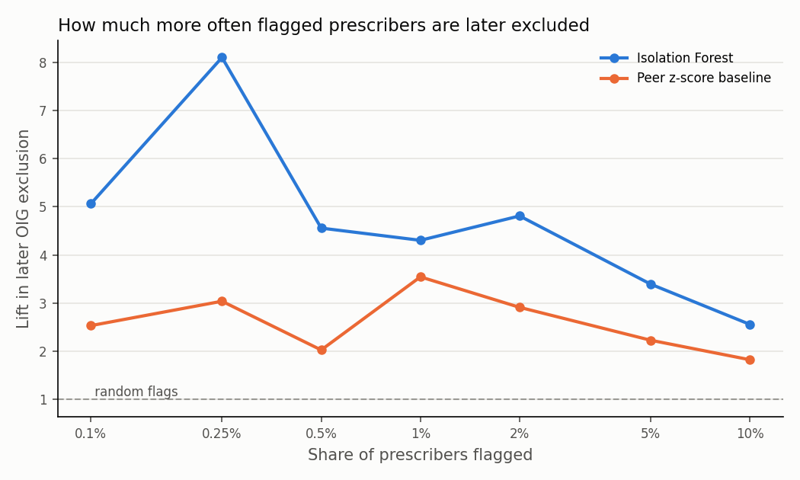
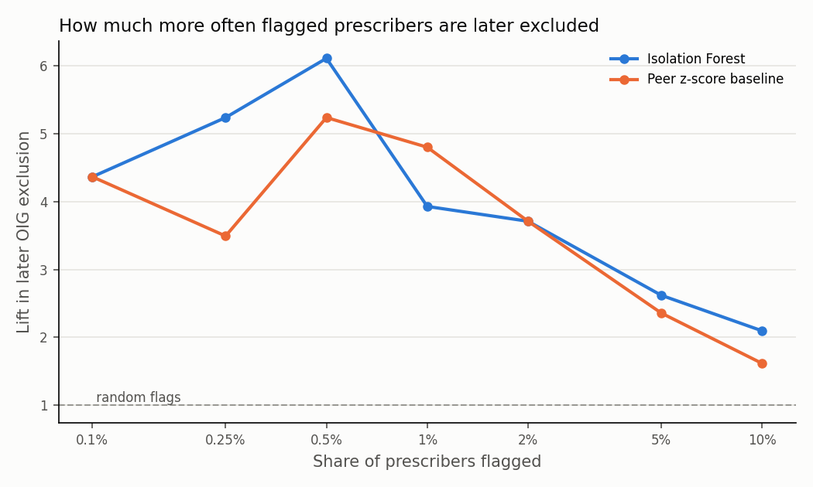

# partd-prescriber-anomaly

Peer-relative anomaly detection for Medicare Part D prescribers, using an Isolation Forest checked against a statistical baseline and against later exclusions from Medicare. Built in Python and SQL, and runs unchanged on a laptop (DuckDB) or in Databricks (Spark, with MLflow tracking).

> **Status.** 2023 and 2024 data years complete. See the roadmap below.

## Background

Program integrity teams look for providers whose billing departs from their peers, then review the most unusual ones by hand. Rules such as "more than three standard deviations above the specialty average" are easy to explain but only look at one measure at a time. An Isolation Forest scores how easy a provider is to separate from everyone else across all measures at once, so it can surface unusual combinations that no single rule would catch.

Without fraud labels, the hard part is showing that the flags mean anything. This project tests that two ways. It compares the forest with a simple peer z-score rule, and it checks whether flagged prescribers were later excluded from Medicare by the HHS Office of Inspector General more often than chance would predict.

## Data

**Medicare Part D Prescribers by Provider** (CMS), data years 2023 and 2024. One row per prescriber, with claims, costs, days of supply, beneficiary counts, and brand, opioid, and antibiotic subtotals. About 1.4 million rows. Counts from 1 to 10 are suppressed by CMS.

**List of Excluded Individuals and Entities, LEIE** (HHS Office of Inspector General). Every current exclusion from federal health care programs, with NPI, exclusion type, and date.

Neither file is redistributed here. See *How to run* for download steps.

## Methods

1. **Build.** SQL steps in `sql/build/` filter the file and compute features. The row count after every step is written to `output/2024/record_counts.csv`, so every drop can be traced and explained.
2. **QC.** `sql/qc/qc_checks.sql` produces *error* checks, which must be zero, and *info* checks that describe the data. The run stops if an error check fails.
3. **Peer comparison.** Each feature becomes a robust z-score within the prescriber's specialty and state, using the median and MAD.
4. **Score.** An Isolation Forest and a peer z-score baseline each rank every prescriber, and the top 1% are flagged.
5. **Validate.** Lift, precision, AUROC, and a hypergeometric p-value against later exclusion, for both methods and a random reference. Flag stability across random seeds. Agreement between the two methods.
6. **Sensitivity.** Each analytic choice is varied one at a time and logged to MLflow.

Every choice and its reason is recorded in [docs/modeling_decisions.md](docs/modeling_decisions.md).

## Results (2023 data year, primary analysis)

Rank-based peer scores were declared the primary method after the 2024 run and before this one (decision D21). 2023 also allows almost three years for exclusions to happen, against under two for 2024.

**Analysis file.** 1,380,665 prescribers in the file, 1,236,075 after the filters. Every error-level QC check is zero. Full counts are in `output/2023/record_counts.csv`.

**Outcome.** 2,313 NPIs were excluded after 2023, and 395 of them are in the analysis file, 133 for fraud-related reasons. Random flags on 1% of prescribers would catch about 4.

**Validation, top 1% flagged (12,361 prescribers)**

| Method | Later excluded among flagged | Lift | AUROC | p-value vs random |
|---|---|---|---|---|
| Isolation Forest | 17 | 4.3 | 0.63 | under 0.001 |
| Peer z-score baseline | 14 | 3.5 | 0.59 | under 0.001 |
| Random flags | 2 | 0.5 | 0.51 | 0.91 |

For fraud-related exclusions only, both methods flagged 5 of the 133 (lift 3.8), with AUROC 0.64 for the forest and 0.61 for the baseline.



**Findings**
1. **The forest beats the baseline at every cutoff.** From 0.1% to 10% flagged, its lift is higher each time, peaking at 8.1 when 0.25% are flagged (8 of 3,090 later excluded).
2. **The method chosen in advance held up.** In the sensitivity sweep, the median and MAD version caught 11 excluded prescribers (lift 2.8, AUROC 0.60), against 17 for the rank-based primary.
3. **The specialty imbalance halved again.** The highest flag rate among large specialties was 3.6%, against 6.4% for the median and MAD version, the same pattern seen in 2024.
4. **Flags now lead with volume and cost.** The most common leading reasons are cost per beneficiary (2,603 flags) and claims per beneficiary (1,667), rather than antibiotic share.
5. **The two methods agree far less than in 2024.** Only 3,024 prescribers are flagged by both (Jaccard 0.14). Part of this is by design, since rank-based scores reshape every feature. Part may be a handicap for the baseline. Under rank-based scores, the most extreme possible score depends on peer group size, so the baseline's top ranks favor members of large groups. A check with `--scaling robust` is on the roadmap.
6. **Stability is similar to 2024.** The mean Jaccard of flagged sets across five seeds is 0.70.

**Sensitivity**

| Variant | Excluded among flagged | Lift | AUROC | Primary flags kept | Highest specialty flag rate |
|---|---|---|---|---|---|
| Primary (rank-based) | 17 | 4.3 | 0.63 | 100% | 3.6% |
| Peer group national only | 18 | 4.6 | 0.64 | 76% | 3.3% |
| Larger state peer minimum (100) | 18 | 4.6 | 0.63 | 93% | 3.5% |
| Above-peer deviations only | 18 | 4.6 | 0.58 | 33% | 3.5% |
| Without patient risk score | 21 | 5.3 | 0.64 | 80% | 3.3% |
| max_samples 1024 | 19 | 4.8 | 0.63 | 85% | 3.8% |
| n_estimators 100 | 17 | 4.3 | 0.64 | 86% | 3.5% |
| max_features 0.5 | 14 | 3.5 | 0.63 | 81% | 3.8% |
| Median and MAD peer scores | 11 | 2.8 | 0.60 | 42% | 6.4% |

Dropping the patient risk score was the best variant in both years (21 against 17 here, 14 against 9 in 2024). That makes it a candidate to declare in advance for the next data year, not a reason to change these results.

## Results (2024 data year, median and MAD peer scores)

**Analysis file.** The Part D file has 1,416,883 prescribers. After the filters in `sql/build/`, 1,270,084 remain. Most of the drop (145,472 rows) is prescribers whose beneficiary count CMS suppressed. Every error-level QC check is zero. Full counts are in `output/2024/record_counts.csv`.

**Outcome.** The LEIE lists 84,224 exclusions, of which 9,023 carry an NPI and 1,445 NPIs were excluded after 2024. Of those, 229 are in the analysis file, 71 of them for fraud-related reasons. That is a base rate of 0.018%, so random flags on 1% of prescribers would catch about 2.

**Validation, top 1% flagged (12,701 prescribers)**

| Method | Later excluded among flagged | Lift | AUROC | p-value vs random |
|---|---|---|---|---|
| Isolation Forest | 9 | 3.9 | 0.60 | 0.001 |
| Peer z-score baseline | 11 | 4.8 | 0.56 | under 0.001 |
| Random flags | 1 | 0.4 | 0.50 | 0.90 |

For fraud-related exclusions only, the forest flagged 4 of the 71 (lift 5.6) and the baseline 3 (lift 4.2).



**Findings**
1. **Both methods carry real signal.** Flagged prescribers were later excluded about 4 to 5 times as often as chance would predict.
2. **The forest ranks better overall, but the margin is small.** Its AUROC is higher, and its lift is higher at 0.25%, 0.5%, 5%, and 10% flagged. The baseline catches two more at exactly 1%. With 229 events, a difference of a few prescribers is within noise.
3. **The two methods mostly agree.** 9,949 prescribers are flagged by both (Jaccard 0.64), and the rank correlation of their scores is 0.90. The 2,752 flagged only by the forest are prescribers with unusual combinations of measures that are each only moderately high.
4. **The flags are moderately stable.** Across five random seeds the flagged sets overlap with a mean Jaccard of 0.72, so roughly a quarter of the prescribers near the cutoff change from seed to seed.
5. **Self-reported specialty is a rough peer group.** 4.8% of family physicians and 6.1% of pharmacists were flagged, against 0.3% of nurse practitioners. For family physicians, most flags lead with a high antibiotic share, which fits urgent care physicians who enroll as Family Practice. See D20 in the decisions file.

**Sensitivity.** Each row changes one choice from the primary analysis.

| Variant | Excluded among flagged | Lift | AUROC | Primary flags kept | Highest specialty flag rate |
|---|---|---|---|---|---|
| Primary | 9 | 3.9 | 0.60 | 100% | 6.1% |
| Peer group national only | 10 | 4.4 | 0.60 | 76% | 7.6% |
| Larger state peer minimum (100) | 11 | 4.8 | 0.60 | 94% | 6.2% |
| Above-peer deviations only | 8 | 3.5 | 0.58 | 48% | 6.7% |
| Without patient risk score | 14 | 6.1 | 0.61 | 83% | 6.2% |
| max_samples 1024 | 12 | 5.2 | 0.60 | 80% | 8.8% |
| n_estimators 100 | 10 | 4.4 | 0.60 | 89% | 6.3% |
| max_features 0.5 | 11 | 4.8 | 0.60 | 83% | 7.8% |
| Rank-based peer scores | 14 | 6.1 | 0.63 | 42% | 3.3% |

The rank-based version stands out. It halves the specialty imbalance and has the highest AUROC, while flagging a very different set of prescribers. It was not chosen as the primary analysis here, because choosing settings after seeing the exclusions would overstate how well the model works. It was declared as the primary analysis for the 2023 run before that run happened, and the 2023 results above confirm it.

## Repository layout

```
run_all.py                 laptop run with DuckDB
notebooks/                 Databricks notebook (same pipeline on Spark, logs to MLflow)
src/partd_anomaly/         engine adapter, features, models, validation, MLflow logging
sql/build/                 one file per filtering or feature step
sql/qc/                    quality checks
tests/make_synthetic.py    synthetic stand-ins with the real column names
docs/                      modeling decisions
output/<year>/             record counts, QC, validation, and figures for each data year
output/<year>/private/     flagged prescribers with NPIs (never committed)
```

## How to run

1. **Download the data** into the folder that holds this repo. Any subfolder works, since `run_all.py` searches for the files by name.
   * Part D Prescribers by Provider from [data.cms.gov](https://data.cms.gov/provider-summary-by-type-of-service/medicare-part-d-prescribers/medicare-part-d-prescribers-by-provider). The file is named like `mup_dpr_ry26_p04_v20_dy24_npi.csv`, where `dy24` is the data year.
   * The LEIE `UPDATED.csv` from the [OIG exclusions page](https://oig.hhs.gov/exclusions/exclusions_list.asp).

   My layout looks like this.
   ```
   Isolation Forest Model/
     UPDATED.csv
     Medicare Part D Prescribers - by Provider/
       Medicare Part D Prescribers - by Provider/
         2024/
           mup_dpr_ry26_p04_v20_dy24_npi.csv
     partd-prescriber-anomaly/      (this repo)
   ```

**On a laptop** (Windows Command Prompt, Python 3.10 to 3.13). Set up once.
```
cd "%USERPROFILE%\Documents\Isolation Forest Model\partd-prescriber-anomaly"
py -3.12 -m venv .venv
.venv\Scripts\activate
pip install -r requirements.txt
```
Then run it, giving the data year of the Part D file.
```
.venv\Scripts\activate
python run_all.py --year 2024 --scaling robust
python run_all.py --year 2023
```
Each year's results go to `output\2024` or `output\2023`. The first command reproduces the 2024 analysis, which used median and MAD peer scores. From 2023 on, rank-based scores are the default (decision D21). The run prints which files it found, the row count after each step, the QC checks, and the validation results. To browse the MLflow runs afterward, type `mlflow ui` and open http://127.0.0.1:5000. Add `--no-sweep` for a quicker first run, or `--partd` and `--leie` to point at files elsewhere.

**In Databricks** (the Free Edition works).
1. Add this repo as a Git folder.
2. Create a volume `workspace.default.partd` and upload both CSVs to it.
3. Open `notebooks/partd_isolation_forest.py`, check the widget paths, and run all.

**Without downloading anything.** The synthetic files exercise every step in under a minute.
```
python tests/make_synthetic.py --out tests/synthetic
python run_all.py --partd tests/synthetic/partd_synthetic.csv --leie tests/synthetic/leie_synthetic.csv --out tests/synthetic/output
```

## Roadmap

1. ~~Pipeline, QC, peer features, Isolation Forest, baseline, validation, MLflow~~
2. ~~Run on the 2024 file and write up the results~~
3. ~~Rerun on 2023 with rank-based peer scores declared in advance as the primary analysis~~
4. Rerun 2023 with `--scaling robust` to give the baseline its original form, and keep the baseline on median and MAD scores in future runs
5. Average scores across several seeds for steadier flags near the cutoff
6. SHAP values for flagged prescribers, alongside the plain-language reason codes
7. A state map of flag rates
8. A two-page white paper on methods and findings

## Limitations

Being unusual is not evidence of fraud. Many flagged prescribers will have legitimate reasons, such as a specialized practice or a sicker patient panel. Later exclusion is an incomplete outcome, since most fraud is never prosecuted and some exclusions are for reasons unrelated to billing. Suppression by CMS removes the smallest prescribers and blanks some subtotals. Specialty is self-reported in Medicare enrollment and does not always reflect what a provider actually does.

## Acknowledgments

Built with Claude as an AI coding assistant. Design decisions, review, and interpretation are my own.
